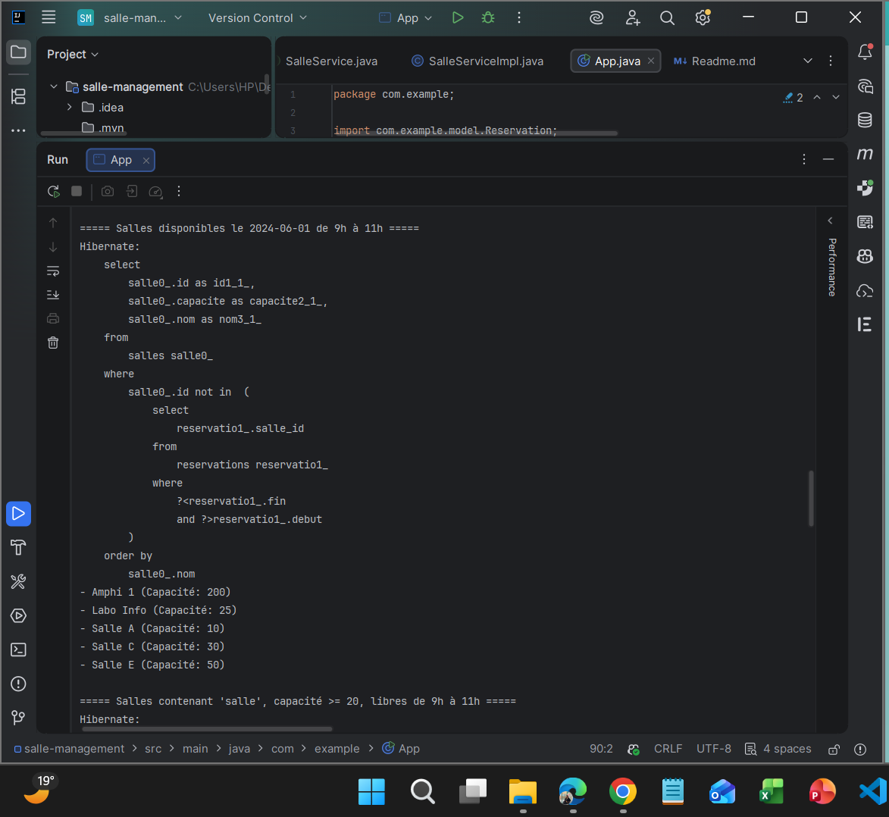
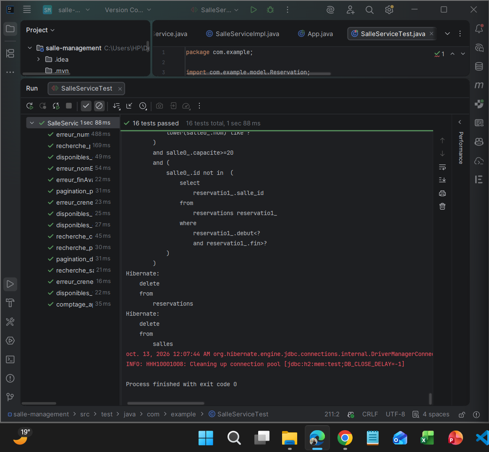

# TP5 – Requêtes avancées JPA : JPQL, Criteria et pagination

Application Java SE de gestion de salles avec JPA / Hibernate et une base **H2 en mémoire** : recherche des salles disponibles sur un créneau (JPQL), recherche multi-critères dynamique (API Criteria) et pagination côté serveur, organisées en couches Repository / Service.

## Technologies

| Outil | Version |
|---|---|
| Java (compilation) | 11 |
| Hibernate ORM | 5.6.15.Final |
| JPA (`javax.persistence`) | 2.2 |
| H2 Database | 2.1.214 |
| JUnit | 4.13.2 |
| Maven | 3 |

## Architecture

```
src/
├── main/
│   ├── java/com/example/
│   │   ├── App.java                         démonstration
│   │   ├── model/                           Salle, Reservation
│   │   ├── repository/                      SalleRepository, SalleRepositoryImpl
│   │   ├── service/                         SalleService, SalleServiceImpl
│   │   └── util/                            PaginationResult
│   └── resources/META-INF/persistence.xml
└── test/java/com/example/
    └── SalleServiceTest.java                16 tests JUnit
```

```
App / Tests  →  SalleService (validation)  →  SalleRepository (JPQL, Criteria)  →  EntityManager  →  H2
```

## Modèle

- **Salle** : `nom` (unique), `capacite`, et ses réservations (`@OneToMany`, `cascade = ALL`, `LAZY`).
- **Reservation** : `debut`, `fin` (`LocalDateTime`) et sa salle (`@ManyToOne`, `LAZY`, clé étrangère `salle_id`).

## Fonctionnalités

### Salles disponibles (JPQL)

Une salle est libre si **aucune** réservation ne chevauche le créneau. Deux créneaux se chevauchent si l'un commence avant que l'autre finisse :

```sql
SELECT s FROM Salle s WHERE s.id NOT IN (
    SELECT r.salle.id FROM Reservation r WHERE :debut < r.fin AND :fin > r.debut
) ORDER BY s.nom
```

La fin est **exclue** : une réservation de 9h à 11h ne bloque pas un créneau qui commence à 11h.

### Recherche multi-critères (Criteria)

Nom (insensible à la casse), capacité minimale et disponibilité. Chaque critère est **facultatif** : il n'est ajouté à la requête que s'il est renseigné. La disponibilité utilise une **sous-requête** Criteria.

### Pagination

`setFirstResult((page - 1) * size)` et `setMaxResults(size)`, avec un tri par nom pour que les pages soient stables. Le comptage (`countRooms`) réutilise **exactement les mêmes critères** (méthode commune `construireCriteres`), pour que le nombre de pages soit juste. `PaginationResult` renvoie les éléments, la page courante, le total et `hasNext()` / `hasPrevious()`.

### Règles métier (service)

Le service refuse un créneau incohérent (fin avant ou égale au début, une seule date fournie) et un numéro ou une taille de page inférieurs à 1.

## Adaptations par rapport à l'énoncé

- **Pas d'EJB ni de CDI** : `@Stateless`, `@PersistenceContext` et `@Inject` ne fonctionnent qu'avec un serveur Java EE. En Java SE, les dépendances sont passées **par le constructeur** : `new SalleServiceImpl(new SalleRepositoryImpl(em))`.
- **Données de démonstration** : `App` insère 7 salles et 3 réservations, sinon la recherche renverrait une liste vide.
- **Collection initialisée** : `reservations = new HashSet<>()`, avec une méthode `addReservation()` qui met à jour les deux côtés de la relation.

## Exécution

```bash
mvn clean compile exec:java
```



## Tests

Une seule `EntityManagerFactory` partagée (`@BeforeClass`), un `EntityManager` neuf par test, et la base vidée après chaque test.

| Catégorie | Tests |
|---|---|
| Disponibilité (JPQL) | chevauchement, créneau qui commence pile à la fin d'une réservation, créneau inclus dans une réservation, jour sans réservation |
| Multi-critères (Criteria) | nom insensible à la casse, capacité minimale, combinaison des 3 critères, sans critère |
| Pagination | découpage en pages et dernière page incomplète, page au-delà de la fin, comptage cohérent avec la recherche |
| Cas d'erreur | fin avant début, créneau de durée nulle, créneau incomplet, page 0, nom en double avec rollback |

```bash
mvn clean test
```

